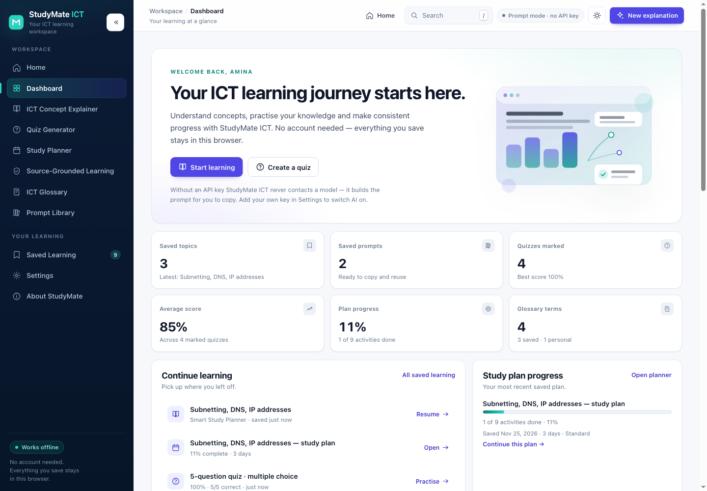
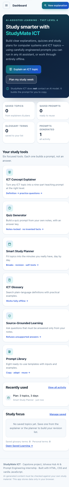
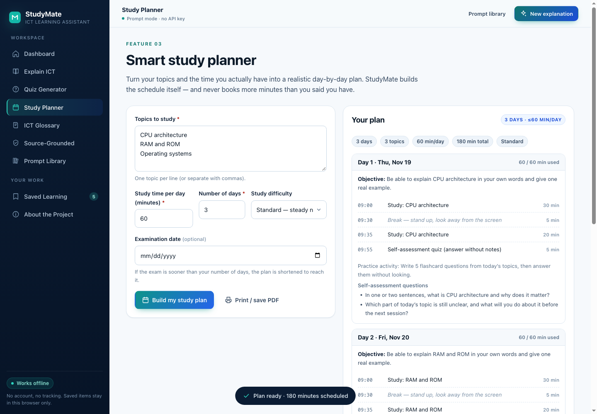
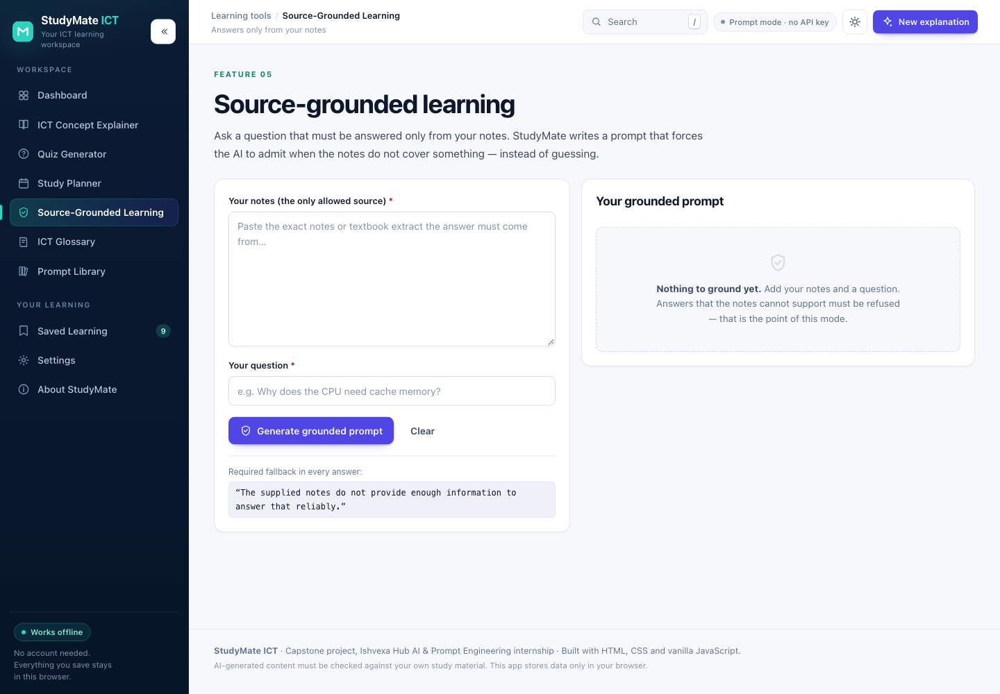

# StudyMate ICT

An ICT study assistant for beginner and intermediate students: AI-generated concept explanations, practice quizzes marked in the browser, a study planner that tracks what you actually finish, a 41-term glossary, source-grounded learning and a prompt library — installable as a PWA and fully usable offline.

**Live demo (production):** <https://studymate-ict-04s0d8.freebuff.site/> · **Preview:** <https://studymate-ict-04s0d8-preview.freebuff.site/>

Both addresses serve the same 2.4.0 build from the same `dist/` bundle, so every view — including the `#/home` landing page and the `#/api` API Reference page — looks and behaves identically on each. If you visited either address before the latest deployment, reload once (or clear the site's cached service worker) to pick up the new shell.

The public demo has no AI key configured, so it runs in **prompt mode** and says so in the status chip. Every tool works; the AI buttons are disabled until a key is added. See [AI setup](#ai-setup).

---

## What is here

| Path | What it is |
|---|---|
| `StudyMate-ICT/` | The application: `index.html`, `css/`, `js/`, `sw.js`, `manifest.webmanifest`, icons, screenshots and the seven project documents |
| `StudyMate-ICT/js/ai-contract.js` | The AI contract shared by both paths: prompts, request validation, JSON parsing, response schemas |
| `sites/` | Deployment for the public demo: `worker.js` (static assets + `/api/*`) and `ai-core.js` (config, provider call, rate limiting — it imports the shared contract) |
| `server/` | Zero-dependency Node server for Render and local development: `node-server.js` |
| `tests/` | 54 automated tests: AI validation, HTTP surface, security, quiz marking, settings, learner-key mode, navigation |
| `docs/` | Deployment, provider, troubleshooting and changelog documents |
| `build.sh` | Regenerates `dist/`, the deploy bundle |
| `dist/` | The committed deploy bundle (30 files) that both hosting configs serve |
| `wrangler.jsonc` | Root Workers config (`sites/worker.js` + `./dist` assets) — what Freebuff **Publish** detects |
| `render.yaml` | Render Blueprint (one Web Service) |

## Stack

HTML5, modern CSS and vanilla JavaScript for the app — no framework, no bundler, no runtime dependency in the browser. One optional Node service (Node 22, no npm packages) provides the AI endpoint and serves the static build. Data lives in LocalStorage.

## Architecture

```
Browser (static app, offline-capable)
   │  POST /api/ai        (JSON in → validated JSON out)
   │  POST /api/ai                              │  POST <provider>/chat/completions
   ▼                                           ▼
Server (server/node-server.js  |  sites/worker.js)      learner's provider
   │  sites/ai-core.js
   │  both paths share js/ai-contract.js
   ▼
OpenAI-compatible provider  ←  AI_API_KEY (server env only)
```

- The **key never reaches the browser**. `/api/health` reports only whether one is configured.
- A learner can instead **bring their own key** (`js/local-ai.js`): it stays in their browser's LocalStorage and is sent only to the provider they chose, never to this server.
- The server validates the request, applies timeouts and per-client/daily limits, then validates the model's JSON against a strict schema. Malformed output is a 502, not a half-drawn screen. The prompts and those checks live once, in `js/ai-contract.js`, and are applied identically on the browser path.
- Without a key the endpoint answers `503 ai-not-configured` and the app stays in prompt mode, which needs no network at all.
- The service worker precaches 28 app-shell URLs and never intercepts `/api/*`, so a cached health check cannot misreport the deployment. `build.sh` stamps its cache name with a hash of the built shell, so a browser holding an older worker cannot keep serving stale HTML, CSS or JS after a build.

## Interface and design system

The app opens on a **workspace dashboard**, not a marketing page. There is no login, registration, email field or account of any kind: the dashboard is the first screen, and every non-AI tool works with no key.

- **Shell.** A fixed sidebar (brand, a *Workspace* group led by **Home**, a *Your learning* group and a live saved-items badge) and a topbar with a **Home** button, breadcrumbs, a page hint, global search, the real AI-status chip, a theme toggle and one primary action. The sidebar collapses to icons with tooltips and remembers the choice; below 900px it becomes an off-canvas drawer with a `☰` trigger and `Escape` to close. A footer carries the project attribution.
- **Dashboard.** Welcome panel with a learner illustration, *Start learning* / *Create a quiz*, six real metrics (saved topics, saved prompts, quizzes marked, average score, plan progress, glossary terms), continue-learning rows, study-plan progress, the six tool cards, a quiz-score chart, recent activity and study focus. Every number is computed from LocalStorage; a new learner sees honest zero states, never invented counts or streaks.
- **Design tokens.** All colour, spacing, radius, shadow and type decisions live in `:root` in `css/styles.css`; the dark theme redefines the same tokens under `html[data-theme="dark"]`, so every component follows without per-screen overrides. The typeface is the operating system's UI font stack and the icons are one inline SVG sprite — no web fonts, icon CDNs or CSS frameworks, which keeps the PWA offline-capable.
- **Components.** Stat tiles, tool cards, workbenches, chips, segmented controls, empty states, callouts, saved-item rows and result rows share the same tokens and states. Class names the JavaScript modules query were kept, so behaviour did not change with the styling.
- **Global search** (`/` or `Ctrl/Cmd + K`) covers pages, all 41 glossary terms, saved topics and prompts, personal terms and the active plan. Results are ranked (title, then category, then body) and grouped, navigable with arrow keys and `Enter`, and glossary or saved results deep-link with the target field pre-filled.
- **Responsive and accessible.** Layouts were checked from 320px to 1920px with no horizontal scrolling. Landmarks, a skip link, one `h1` per view, labelled fields, visible focus rings, `aria-live` status messages, `prefers-reduced-motion` support and AA text contrast are built in.

## Screenshots

All captured from the live build on 25 November 2026 (including the Home button); the data shown is demo data saved in the browser. These views are unchanged in 2.4.0, which added the API Reference page.

| Dashboard | Mobile dashboard |
|---|---|
|  |  |

| Study planner | Source-grounded learning |
|---|---|
|  |  |

## Quick start

```bash
git clone <this repo>
cd <repo>
./build.sh                  # writes dist/ (30 files)
node server/node-server.js  # http://localhost:3000
```

No install step: the server has no dependencies. Open <http://localhost:3000>. For live AI:

```bash
cp .env.example .env        # then put your key in AI_API_KEY
node --env-file=.env server/node-server.js
```

The static app also runs offline straight from disk by opening `StudyMate-ICT/index.html` — the service worker is skipped on `file://`.

## Two ways to switch AI on

StudyMate starts in prompt mode until *some* key exists. Either route works, and the Home page explains both:

1. **Your own key, in this browser — no server needed.** Open **Home** (or **Settings**) and use the **Add an AI provider** panel. It ships with a searchable catalogue of **47 provider presets** — OpenAI, Anthropic Claude, Google Gemini, OpenRouter, Groq, Mistral, DeepSeek, Together, Fireworks, Perplexity, xAI, Cohere, Cerebras, SambaNova, DeepInfra, Novita, Nebius AI Studio, NVIDIA NIM, Hugging Face, Qwen (DashScope), Kimi, GLM, Yi, MiniMax, Hunyuan, Doubao, Sarvam, Azure OpenAI, Cloudflare, GitHub Models, local Ollama / LM Studio / llama.cpp / vLLM and more — plus an *Other provider* option for any custom gateway. Choosing a provider fills in its base URL and model for you.
   The panel then **tests the URL automatically** as you type it: it reports reachability, latency, how many models the key can use, and whether the provider refuses browser (CORS) requests. **Fetch models** lists everything the key is allowed to use; **Test connection** sends one tiny request to prove the key and model work together, before you save anything. Three protocols are supported natively — OpenAI-compatible, Anthropic Messages and native Gemini — so those providers work without a proxy.
   The key is stored in this browser's LocalStorage **on your computer**, sent only to the provider you chose, and never to this app's server. This works on the public demo and on any static hosting.
2. **A key on the server — for deployments you own.** Set `AI_API_KEY` (plus `AI_BASE_URL` / `AI_MODEL`) on Render or your Node host. The key stays server-side and every request is validated and rate limited by the server.

Some providers block browser requests (CORS). The URL test says so explicitly; those providers need option 2.

## AI setup (server-side key)

1. Get a key for any OpenAI-compatible provider (OpenAI, OpenRouter, a self-hosted gateway).
2. Set `AI_API_KEY` in the **server** environment — `.env` locally, Environment → `AI_API_KEY` on Render. Never put it in the frontend.
3. Optionally set `AI_BASE_URL`, `AI_MODEL`, `AI_JSON_MODE`, `AI_RATE_LIMIT`, `AI_RATE_WINDOW_MS`, `AI_DAILY_CAP`, `AI_TIMEOUT_MS` (all documented in `.env.example`).
4. Restart, check `GET /api/health` → `configured: true`, then press **Explain with AI** once. The chip only reads “AI live” after a real request succeeds.

The contract, error map and how to add another provider: [`docs/AI_PROVIDER.md`](docs/AI_PROVIDER.md).

## Tests

```bash
npm test
```

54 tests, no dependencies, using Node's built-in runner. They cover request validation and schema enforcement, provider failures, rate limiting, key non-disclosure, HTTP headers, path-traversal protection, the SPA fallback, quiz marking, settings normalisation, the learner-key path (base-URL checks, the provider being called with the learner's own key, rejected keys, and refusal of malformed model output), the provider catalogue (unique ids, valid HTTPS bases, grouping, URL normalisation and detection, search), the three request protocols (OpenAI, Anthropic Messages, Gemini), including the automatic URL probe and its CORS/timeout/refused-key reporting, and the app shell (every navigation entry has a view; Home is reachable from the topbar and the sidebar). Results and the full QA table are in [`StudyMate-ICT/TESTING_REPORT.md`](StudyMate-ICT/TESTING_REPORT.md) §2–§9.

Manual browser checks during the 2.2.0 redesign (Chromium, Playwright): the dashboard-first route and no-login entry; all 11 views rendering with one `h1` each; horizontal overflow measured at 320, 375, 390, 430, 768, 1024, 1280, 1440 and 1920 px (zero everywhere); sidebar collapse, tooltips and persistence; mobile drawer open/close/`Escape`/route change; search ranking, grouping and `Enter` deep link; saved search and category filter; quiz generation against a stubbed OpenAI-compatible endpoint, full marking at 100% and the dashboard metrics updating; planner build (3 days, 9 activities), save, tick and persistence across reload; theme persistence; offline reload from the service worker; and an accessibility sweep (duplicate IDs, unlabelled fields, unnamed buttons, missing `alt`, heading order). For 2.4.0, all twelve routes (including the new `#/api` API Reference page with its 7 documentation tables, 6 code blocks and live `/api/health` values) were re-checked at 1440px and 390px on both live addresses — 48 route/viewport checks, each rendering the right view and a single `h1` with its sidebar entry current, zero horizontal overflow, the Home button present and marked current only on Home, and no console or page errors — and all 30 deployed files plus the health payload are identical between preview and production. **A real third-party AI provider was not tested — only a stubbed endpoint — and no screen reader, Safari or Firefox pass was run.** The full matrix is in [`StudyMate-ICT/TESTING_REPORT.md`](StudyMate-ICT/TESTING_REPORT.md).

## Deploy

- **Render** (prepared, not deployed here — no account was available): one Web Service, build `./build.sh`, start `node server/node-server.js`, health check `/api/health`. Step-by-step: [`docs/RENDER_DEPLOYMENT.md`](docs/RENDER_DEPLOYMENT.md).
- **Freebuff Sites** (the live demo): a Cloudflare Workers project — `wrangler.jsonc` at the root, `sites/worker.js` as `main`, assets from `dist/`, `/api/*` handled by the Worker. `sites/site.manifest.json` describes the same deployment for the Sites tools.

## Documentation

- [`StudyMate-ICT/README.md`](StudyMate-ICT/README.md) — project overview and how to run it
- [`StudyMate-ICT/PROJECT_DOCUMENTATION.md`](StudyMate-ICT/PROJECT_DOCUMENTATION.md) — architecture, features, data model, security
- [`StudyMate-ICT/USER_GUIDE.md`](StudyMate-ICT/USER_GUIDE.md) — student-facing guide
- [`StudyMate-ICT/TESTING_REPORT.md`](StudyMate-ICT/TESTING_REPORT.md) — test cases, results, what was not tested
- [`StudyMate-ICT/LIMITATIONS_AND_FUTURE_WORK.md`](StudyMate-ICT/LIMITATIONS_AND_FUTURE_WORK.md) — honest limitations
- [`StudyMate-ICT/PRESENTATION_GUIDE.md`](StudyMate-ICT/PRESENTATION_GUIDE.md) — three-minute demonstration script
- [`StudyMate-ICT/PROMPTS_USED.md`](StudyMate-ICT/PROMPTS_USED.md) — the prompt-engineering record
- [`docs/AI_PROVIDER.md`](docs/AI_PROVIDER.md) · [`docs/RENDER_DEPLOYMENT.md`](docs/RENDER_DEPLOYMENT.md) · [`docs/TROUBLESHOOTING.md`](docs/TROUBLESHOOTING.md) · [`docs/CHANGELOG.md`](docs/CHANGELOG.md)

## Licence

[MIT](LICENSE).

## Attribution

StudyMate ICT was developed with AI-assisted support using Freebuff. The project owner provided the project direction and requirements, reviewed the generated implementation, and carried out the documented testing and evaluation.

The test results in this repository were produced by the AI build agent in the development environment on 20 November 2026, and are reported exactly as they occurred; the owner's own review and evaluation are recorded separately.
