# StudyMate ICT

**An offline-first, AI-assisted study assistant for beginner ICT students.**

StudyMate ICT helps learners understand computer-systems concepts, build quizzes from their own notes, plan realistic revision schedules, and learn from source-grounded prompts. It is a capstone project for the **AI and Prompt Engineering internship at Ishvexa Hub**.

> **Important:** StudyMate ICT needs no account, no login and no key. Out of the box it is a *prompt engineering* application: it builds carefully structured prompts that you copy into an AI assistant of your choice, and every tool works fully offline. If you want live answers, you can add **your own** OpenAI-compatible key in Settings (kept in this browser only) or a key on a server you own.

**Live demo:** <https://studymate-ict-04s0d8.freebuff.site/> — installable from the browser, and it keeps working with the network switched off after the first visit.

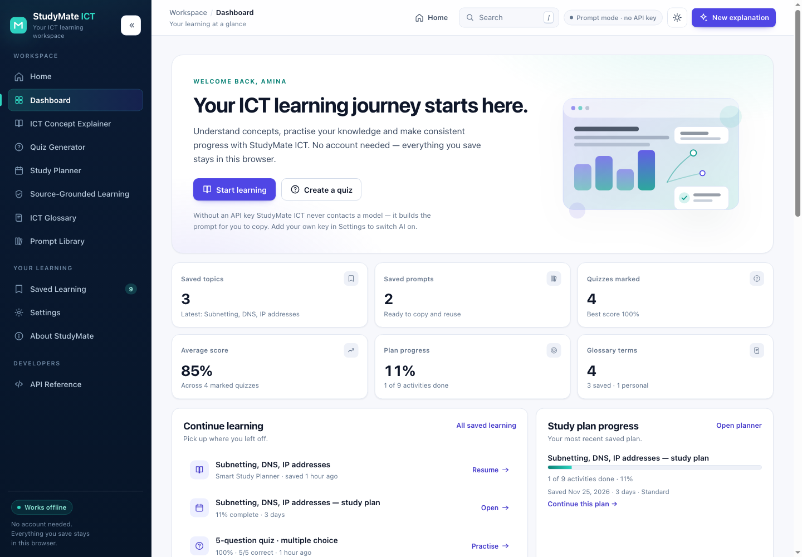

---

## Table of contents

- [Why this project](#why-this-project)
- [Features](#features)
- [Screenshots](#screenshots)
- [Technology stack](#technology-stack)
- [Project structure](#project-structure)
- [Installation and running](#installation-and-running)
- [How to use it](#how-to-use-it)
- [Prompt engineering approach](#prompt-engineering-approach)
- [Responsible AI](#responsible-ai)
- [Testing](#testing)
- [Known limitations](#known-limitations)
- [Documentation](#documentation)
- [Author and acknowledgements](#author-and-acknowledgements)

---

## Why this project

Beginner ICT students meet dense technical language before they have the vocabulary to decode it. Generic AI chat can explain a topic, but the answer quality depends entirely on how the question is asked — and a beginner does not yet know what a good question looks like.

StudyMate ICT solves that by owning the prompt layer:

- Structured, level-aware prompts instead of one-line questions.
- Quizzes locked to the student's own notes, with source lines and an answer key.
- A study plan computed from the time the student actually has.
- A source-grounded mode that must refuse when the notes cannot answer.
- An offline glossary and planner that need no AI at all.

## Features

| # | Feature | What it does |
|---|---------|--------------|
| 1 | **ICT Concept Explainer** | Builds a nine-part teaching prompt: definition, importance, step-by-step, practical example, real-world use, misconceptions, summary, 5 practice questions and answers. Level, prior knowledge and length are embedded in the prompt. |
| 2 | **Quiz Generator** | Paste notes, choose question count, difficulty and type (MCQ / true-false / short answer / mixed). The prompt forbids outside facts, demands a "Source:" line per question and a separate answer key. Empty notes are blocked. |
| 3 | **Smart Study Planner** | Generates an actual day-by-day plan in the browser: objectives, study blocks, real breaks, revision sessions, practice activities and self-assessment questions. Never schedules more than the stated minutes. |
| 4 | **ICT Glossary** | 41 curated terms with plain definitions and practical examples, searchable and filterable. Copy definitions, save them, and add your own terms. |
| 5 | **Source-Grounded Learning** | Builds a strict prompt that answers only from supplied notes, quotes evidence, corrects false assumptions, and must reply with an exact refusal sentence when the notes are insufficient. Includes a transparent keyword coverage check. |
| 6 | **Prompt Library** | Eight complete templates (explainer, hardware comparison, quiz, planner, programming tutor, error troubleshooter, notes summariser, glossary creator) with purpose, inputs, expected output, example and responsible-use note. |
| 7 | **Learning Dashboard** | The first screen: welcome panel, six real metrics (saved topics, saved prompts, quizzes marked, average score, plan progress, glossary terms), continue learning, plan progress, tool cards, quiz-score chart, recent activity and study focus. Empty states instead of invented numbers. |
| 8 | **Saved Learning** | View, copy and delete saved topics, saved prompts, saved glossary terms and activity history. |
| 9 | **About the Project** | Purpose, technologies, AI status and honest limitations. |
| 10 | **API Reference** | Documents the two HTTP endpoints (`GET /api/health`, `POST /api/ai`) with request fields, response shapes, the full error map and the server's environment variables, plus the `window.SM` browser API and the three bring-your-own-key protocols. The live status card reads this deployment's own `/api/health`, so it never claims a key the server does not have. |
| 11 | **Workspace shell and search** | Collapsible sidebar led by Home, with grouped navigation and a saved-items badge, a topbar with a Home button, breadcrumbs, theme toggle and real AI status, a mobile drawer, and global search (`/` or `Ctrl/Cmd + K`) across pages, glossary, saved items and the active plan. |

Plus: no login or registration, offline operation, LocalStorage persistence, responsive layouts from 320px to 1920px, keyboard navigation, visible focus states, empty states, inline validation, a dark theme and print/PDF export of study plans.

## Screenshots

All eleven screenshots were captured from the live 2.4.0 build on 25 November 2026 (including the Home button and the API Reference page that 2.4.0 added), so the API Reference sidebar entry appears in every desktop image. The data shown is demo data saved in the browser.

| ICT Concept Explainer | Smart Study Planner |
|---|---|
| 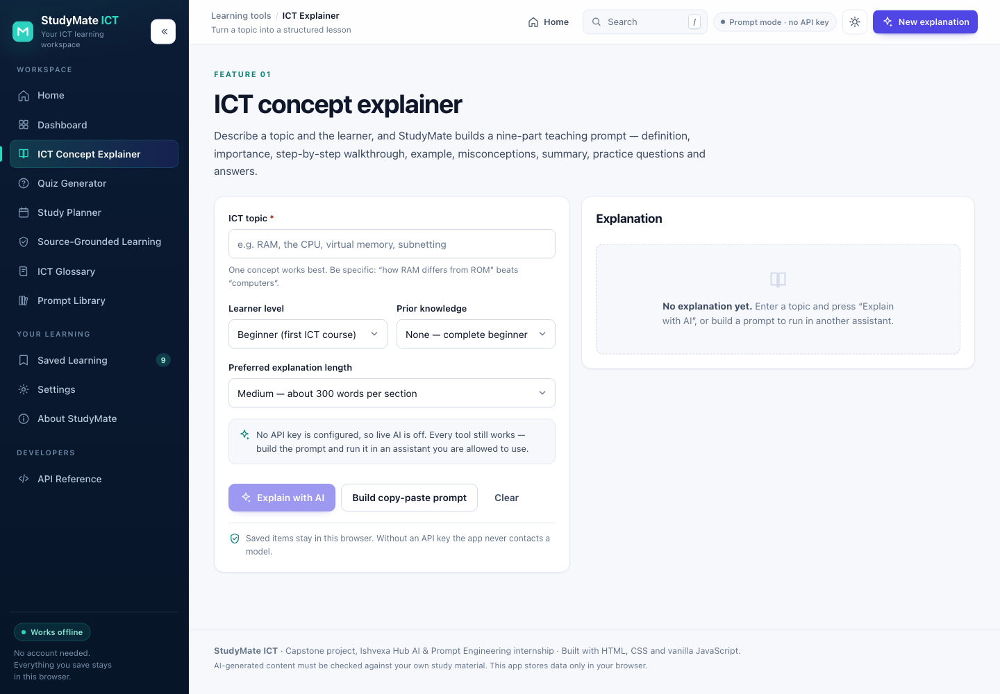 | 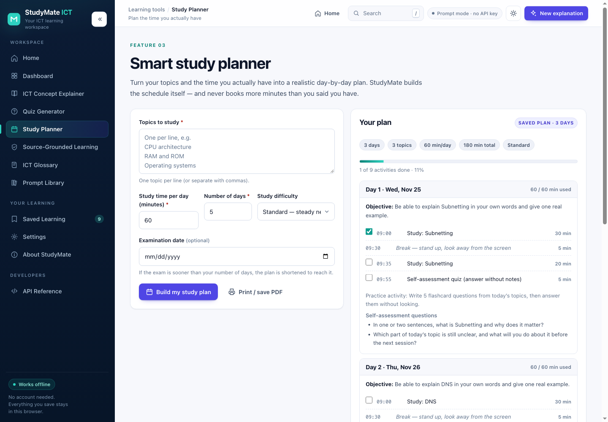 |

| Prompt Library | Source-Grounded Learning |
|---|---|
| 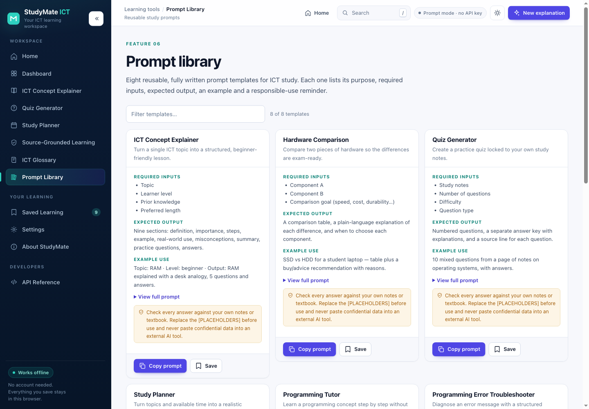 | 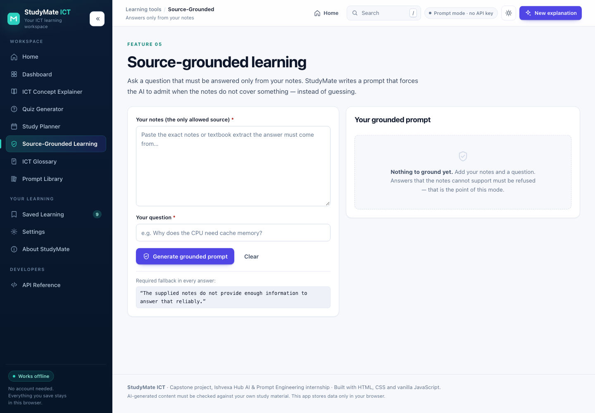 |

| Glossary (mobile) | Study plan on mobile |
|---|---|
| 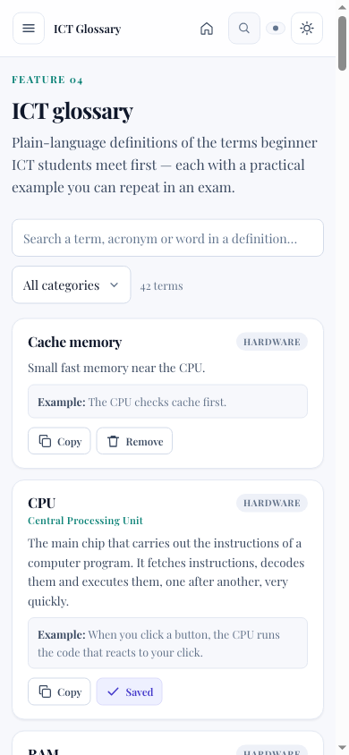 | 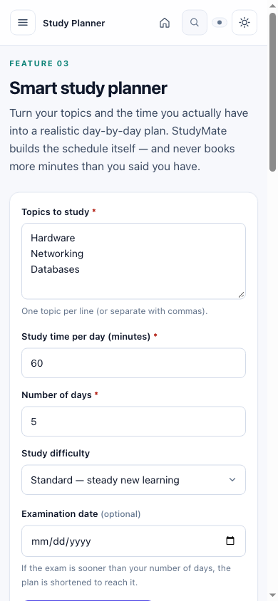 |

| Dashboard (mobile) | Saved Learning |
|---|---|
| 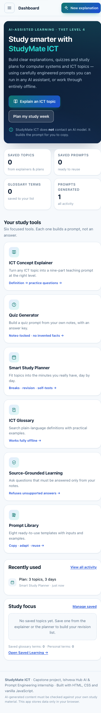 | 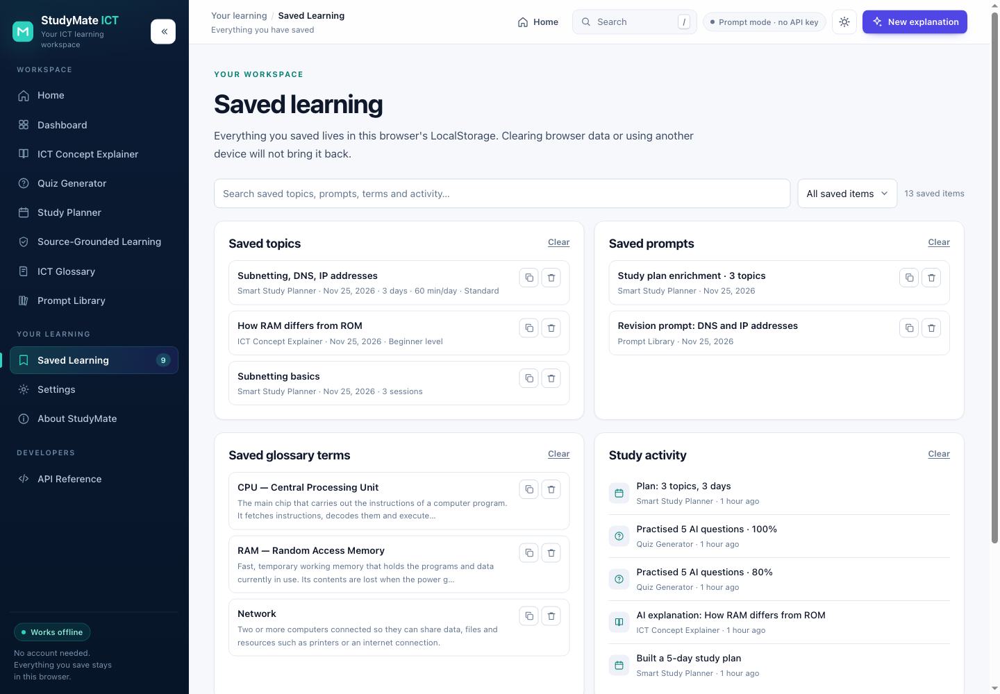 |

| API Reference | API Reference (mobile) |
|---|---|
| 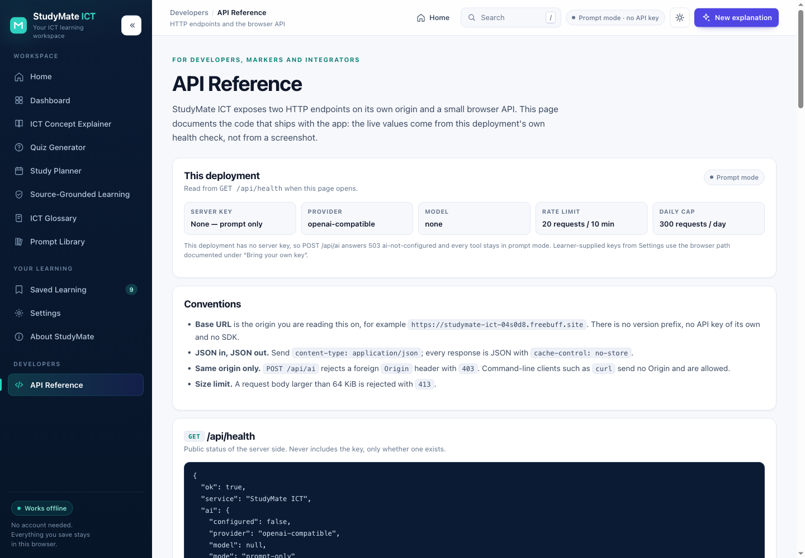 | 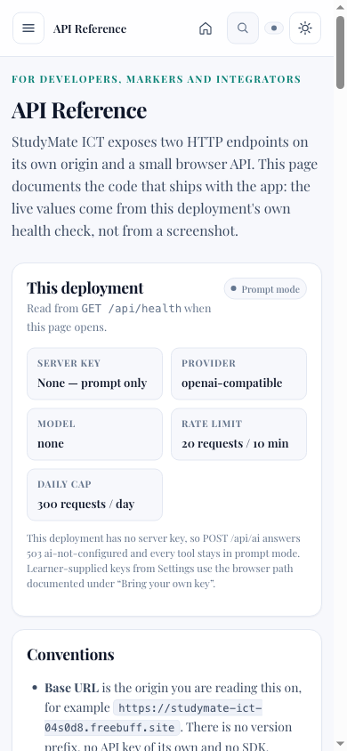 |

## Technology stack

- **HTML5** — semantic, accessible single-page structure.
- **CSS3** — custom design system (dark navy shell, light content surfaces, teal/cyan accents), CSS Grid and Flexbox, media queries, print styles, reduced-motion support.
- **Vanilla JavaScript (ES5-compatible syntax)** — hash router, prompt builders, planner algorithm, glossary search, LocalStorage persistence.
- **LocalStorage** — saved preferences and study items. No backend, database, build step or dependency.
- **No frameworks. No Node.js. No Python. No paid services.**

## Project structure

```
StudyMate-ICT/
├── index.html                  # Application shell and all twelve views
├── css/
│   └── styles.css              # Design system, layout, responsive and print styles
├── js/
│   ├── storage.js              # LocalStorage layer + graceful in-memory fallback
│   ├── ui.js                   # DOM helpers, toasts, clipboard, formatting, tool metadata
│   ├── prompts.js              # Prompt engine + eight library templates
│   ├── glossary-data.js        # 41 curated ICT terms
│   ├── explainer.js            # Feature 1
│   ├── quiz.js                 # Feature 2
│   ├── planner.js              # Feature 3 + scheduling algorithm
│   ├── glossary.js             # Feature 4
│   ├── source.js               # Feature 5
│   ├── library.js              # Feature 6
│   ├── dashboard.js            # Feature 7
│   ├── saved.js                # Saved Learning
│   ├── api-docs.js             # API Reference page: live health values
│   └── app.js                  # Router, navigation, badge, global wiring
├── manifest.webmanifest        # Installable web app metadata (name, icons, shortcuts)
├── sw.js                       # Service worker: precaches the app for offline use
├── assets/
│   ├── favicon.svg
│   ├── icons/                  # 192 px, 512 px and maskable app icons
│   └── screenshots/            # Demonstration images used in the documentation
├── README.md
├── PROJECT_DOCUMENTATION.md
├── USER_GUIDE.md
├── PROMPTS_USED.md
├── TESTING_REPORT.md
├── LIMITATIONS_AND_FUTURE_WORK.md
└── PRESENTATION_GUIDE.md
```

## Installation and running

There is nothing to install.

**Option 1 — open the file directly**

1. Download or unzip the project.
2. Double-click `index.html`.
3. The app runs offline in any modern browser (Chrome, Edge, Firefox, Safari).

**Option 2 — serve it locally** (recommended if your browser restricts LocalStorage on `file://`)

```bash
cd StudyMate-ICT
python3 -m http.server 8000
```

Then open <http://localhost:8000>.

**Option 3 — install it as an app** (Chrome, Edge, or Firefox on Android)

1. Serve the folder (Option 2) or open the live demo.
2. Wait for the first load to finish, then use the browser's **Install** / **Add to Home screen** action.
3. Launch it from the app icon: it opens full-screen with no address bar.

`sw.js` precaches the app shell — `/`, the stylesheet, all 21 scripts, the manifest and the icons (28 files). After one visit the app reloads and navigates with the network switched off, and `manifest.webmanifest` supplies the name, colours and icons the browser needs to install it.

**Network behaviour:** every runtime request is same-origin — there are no fonts, CDNs, analytics or third-party images, so there is nothing that can fail or leak while offline.

No internet connection is needed after the files are on your computer.

## How to use it

1. Open the app and choose a tool from the sidebar (or the dashboard cards).
2. Fill in the form and press the generate button.
3. Read the prompt in the dark panel. Press **Copy prompt**.
4. Paste it into an AI assistant you are allowed to use, or keep it for class discussion.
5. Press **Save** to keep the prompt or topic in **Saved Learning**.

Full walkthrough: [`USER_GUIDE.md`](USER_GUIDE.md).

## Prompt engineering approach

Every prompt assembled by the app follows the same deliberate pattern:

1. **Role** — "You are an experienced ICT tutor…" sets tone and expertise.
2. **Context** — learner level, prior knowledge, length budget, topics, notes.
3. **Task** — explicit numbered output contract (nine sections, question count, answer key).
4. **Constraints** — no invented facts, no invented sources, stay within the minute budget, use only these notes.
5. **Refusal rule** — a fixed sentence for unsupported questions in grounded mode.
6. **Verification** — per-question "Source:" lines and quoted evidence.
7. **Responsible-use footer** — reminds the learner to check against their own material.

Details and all sixteen prompt variants: [`PROMPTS_USED.md`](PROMPTS_USED.md).

## Responsible AI

- No fabricated AI responses: the application never pretends an AI has answered.
- No hidden API keys or network calls.
- No personal accounts and no collection of passwords or confidential data.
- Generated content is always framed as *needs checking*, never as authority.
- The grounded mode refuses rather than guesses, using this exact sentence:
  > "The supplied notes do not provide enough information to answer that reliably."

## Testing

17 browser-driven checks were executed against the served application (functional flows, validation, LocalStorage, navigation, responsive layout, console errors), plus an offline/service-worker check. **All passed** in the final run. Five defects found during testing were fixed and re-tested.

See [`TESTING_REPORT.md`](TESTING_REPORT.md) for the case-by-case results, including what was and was not tested.

## Known limitations

- Prompts, not answers: the app cannot respond without an external AI assistant.
- The planner is a transparent minutes-and-blocks scheduler, not an optimiser.
- LocalStorage is per-browser, roughly 5 MB, and is not a backup.
- The glossary is a curated starter set (41 terms), not a full ICT dictionary.
- The coverage indicator is a keyword heuristic, clearly labelled as such.

More detail: [`LIMITATIONS_AND_FUTURE_WORK.md`](LIMITATIONS_AND_FUTURE_WORK.md).

## Documentation

| Document | Contents |
|---|---|
| [PROJECT_DOCUMENTATION.md](PROJECT_DOCUMENTATION.md) | Problem statement, objectives, audience, system design, features, expected results |
| [USER_GUIDE.md](USER_GUIDE.md) | Step-by-step instructions for every feature |
| [PROMPTS_USED.md](PROMPTS_USED.md) | All prompts, their purpose, inputs, outputs and examples |
| [TESTING_REPORT.md](TESTING_REPORT.md) | 16 test cases with actual results, defects and limitations |
| [LIMITATIONS_AND_FUTURE_WORK.md](LIMITATIONS_AND_FUTURE_WORK.md) | Current limitations and possible improvements |
| [PRESENTATION_GUIDE.md](PRESENTATION_GUIDE.md) | Five-minute capstone demonstration script |

## Licence

Released under the [MIT License](LICENSE). You may use, copy, modify and share the project with attribution.

## Author and acknowledgements

Built as the final capstone project for the **AI and Prompt Engineering internship at Ishvexa Hub**.

Built with HTML5, CSS3 and vanilla JavaScript. The glossary definitions are original plain-language explanations written for this project; no textbook text is reproduced. No external assets, fonts, libraries or images are required at runtime.

---

**Reminder:** AI-generated content must always be checked against your class notes, textbook or lecturer before you rely on it.

---

## What changed in version 2.0 (20 November 2026)

The app began as a prompt-only assistant. It now has an optional **live AI path** while keeping the offline one intact.

- **Explain with AI** — a server endpoint validates the request, calls one OpenAI-compatible provider with a server-side key, and checks the returned JSON before rendering nine structured sections. Prompt mode remains for offline use and deployments without a key.
- **Practice quizzes** — generate questions from your notes, answer them in the app, and get an exact score with review of every wrong answer. Marking happens in the browser, so it is deterministic and works without a second model call.
- **Study-plan progress** — saved plans keep tick marks, show a progress bar, and restore on your next visit.
- **Settings** — light/dark/device theme, default level, preferred subjects, reduced motion, larger text and JSON backup export/import.
- **Tests** — 54 automated tests (`npm test`) plus a documented browser test run.

New documents: [`../docs/AI_PROVIDER.md`](../docs/AI_PROVIDER.md), [`../docs/RENDER_DEPLOYMENT.md`](../docs/RENDER_DEPLOYMENT.md), [`../docs/TROUBLESHOOTING.md`](../docs/TROUBLESHOOTING.md) and [`../docs/CHANGELOG.md`](../docs/CHANGELOG.md).

## Running it locally

```bash
cd ..                 # repository root
./build.sh            # regenerate dist/
node server/node-server.js
# → http://localhost:3000
```

No dependencies to install. With live AI:

```bash
cp .env.example .env         # add AI_API_KEY
node --env-file=.env server/node-server.js
```

The app also opens directly from disk (`index.html`) in prompt mode; the service worker is skipped on `file://`.
